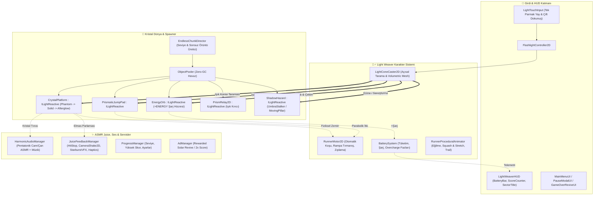

# 🔦 LIGHT WEAVER: Prism Runner — Master Game Design Document (GDD)

> **Proje Kodu:** `LIGHT_WEAVER`  
> **Sürüm:** `v1.0.0-arch` (Pre-Production & Master Architecture Blueprint)  
> **Hedef Motor:** Unity 6 (`6000.x`, Universal Render Pipeline - URP 2D)  
> **Hedef Platformlar:** Mobil (Android & iOS — 60/120 FPS Zero-GC Hedefi) + PC / Editör Test Uyumluluğu  
> **Geliştirme Metodolojisi:** Modüler Veri Güdümlü Mimari, Sıfır Tahsis (Zero-GC), DDA (Deep-Design Architecture)  

---

## 📌 1. YÖNETİCİ ÖZETİ & OYUN KİMLİĞİ (EXECUTIVE SUMMARY)

| Alan | Detay |
| :--- | :--- |
| **Oyun Adı** | **LIGHT WEAVER: Prism Runner** |
| **Tür (Genre)** | 2D Sonsuz Işık Platformeri & Ritmik Aksiyon Koşucusu (*Endless Light-Runner / Hardlight Platformer*) |
| **Temel Kanca (The Rule-Breaker Hook)** | **Zemin Yoktur!** Dünya zifiri karanlık bir hiçliktir (*The Void*). Yalnızca oyuncunun parmağıyla yönlendirdiği fenerin ışık konisi içindeki görünmez kristal kafesler anında **katı, parlayan neon-prizmatik yollara (Hardlight Crystals)** dönüşür. Işığın çekildiği yer saniyeler içinde eriyerek tekrar uçuruma karışır. |
| **Oyun Modları** | **1. Sefer Modu (Sektör Bazlı):** *Level 1 - The Silent Abyss*'ten *Level 5 - The Singularity Core*'a uzanan, her biri özgün kurallara ve Sektör Sonu Boss Kaçış Sekansına sahip aşamalı bölümler. **2. Sonsuz Boşluk (Endless Void):** Giderek hızlanan, pil tüketimi artan ve yüksek skor / liderlik tablosu odaklı sonsuz koşu modu. |
| **Kontrol Şeması** | **Tek Parmak Ergonomisi + İsteğe Bağlı Odak Hamlesi:** Ekrana dokunup sürükleyerek ışık konisini (-65° ile +65° arası) yönlendirme; çift dokunuş veya hızlı ileri kaydırma (*Swipe*) ile **Photon Dash / Parlama Patlaması (Flashbang Parry)**. |
| **Görsel & İşitsel Vibe** | Zifiri karanlık (`#05070D`) boşluk üzerinde camgöbeği (`#00F0FF`), prizmatik eflatun (`#B537F2`) ve sıcak kehribar (`#FFB800`) ışık kırılmaları. Işık kristallere değdiğinde pentatonik cam, arp ve kristal çan tınıları (*Harmonic Crystal ASMR*). |
| **Monetizasyon** | Oyuncu Dostu F2P: Ödüllü Reklamlar (*Acil Solar Şarj ile Canlanma, 2x Lümen Kristali*) + İsteğe Bağlı IAP (*Reklamları Kaldır VIP, Özel Prizma Fener Görünümleri*). |

---

## 🏛️ 2. DERİN OYUN TASARIMI MİMARİSİ (6 EVRENSEL DDA SÜTUNU)

Sıradan bir "koş ve zıpla" oyunu yerine, oyuncunun zihninde akış hali (*Flow State*) yaratan **6 Evrensel DDA (Deep-Design Architecture)** sütunu:

### 2.1. Kural Bozan Sistemik Anomali: "Katılaşan Işık (Hardlight Crystallization)"
* Geleneksel platform oyunlarında zemin sabittir ve oyuncu karakteri zıplatır. **Light Weaver** bu kuralı tersine çevirir: **Oyuncu karakteri değil, dünyanın varoluşunu kontrol eder.**
* Sahnedeki kristal platformlar, rampalar ve zıplama halkaları varsayılan olarak **Hayalet Fazındadır (Phantom State)** — sadece çok soluk (%8 opaklıkta) yıldız tozu izleri olarak görünürler ve fiziksel çarpışmaları (`Collider2D`) kapalıdır.
* Fenerin ışık konisi (`LightConeCaster2D`) bu koordinatları taradığı anda:
  1. **Kristalleşme (Solidify):** Platform 0.06 saniye içinde merkezden dışa doğru camgöbeği/eflatun bir parıltıyla katılaşır, `Collider2D` aktifleşir ve kristal tınısı çalar.
  2. **Artık Parıltı (Afterglow Decay / Coyote Time):** Oyuncu feneri başka bir yöne çevirdiğinde (örneğin havadaki bir bataryayı yakalamak için yukarı tuttuğunda), karakterin altındaki zemin anında yok olup oyuncuyu cezalandırmaz. **0.45 saniyelik bir "Akkor Soğuma" (Afterglow)** süresi boyunca zemin üzerinde çatlayan ışık izleri görünür ve katılığını korur; ardından kristal tozu olarak dağılır.

### 2.2. Çapraz Kilit ve Sistemik Sinerji: "Bakış Açısı İkilemi (The Gaze Dilemma)"
Fener tek bir araçtır ancak **4 farklı sistem** aynı anda fenerin ışığına muhtaçtır. Bu durum her saniye mikro-stratejik kararlar doğurur:
1. **Navigasyon (Yol İnşası):** Karakterin düşmemesi için feneri önündeki/altındaki boşluğa tutmak zorundasın.
2. **Enerji Hasadı (Solar Charging):** Havada yüksekte veya alçakta süzülen **Altın Enerji Hücreleri (`+ENERGY`)** yalnızca fener ışığı üzerlerinde **0.25 saniye** odaklandığında manyetik olarak çekilip şarj olur. Yukarıdaki bataryayı almak için ışığı yukarı kaldırdığında önündeki yolu göremezsin!
3. **Dikey Tırmanış (Auto-Ascension):** Işığı yukarıdaki kristal basamaklara tuttuğunda prizmatik rampalar katılaşır ve karakter hız kesmeden yukarı tırmanır.
4. **Gölge Savunması (Shadow Dissolve):** Karanlıktan süzülen *Gölge Yiyiciler (Umbra Stalkers)* ışığa maruz kaldığında yanarak erir; ancak *Karanlık Madde Dikenleri (Void Spikes)* ışık değdiğinde büyür (onların üzerinden karanlıkta atlamak gerekir!).

### 2.3. Alansal Koreografi ve Tehdit Ayak İzi (Spatial Dynamics)
Her bölüm koridoru **3 Dikey İrtifa Katmanı (Tri-Layer Altitude)** üzerine kurgulanır:
* **Alt Katman (Abyss Edge - Düşük İrtifa):** Geniş ve düz kristal plakalar. Güvenlidir ancak batarya hücresi nadirdir; pilin yavaşça tükenmesine yol açar.
* **Orta Katman (Main Weave - Akış Katmanı):** Kesikli platformlar, **Rezonans Sıçrama Halkaları (Jump Pads)** ve standart enerji hücreleri.
* **Üst Katman (Starlight Canopy - Yüksek Risk / Yüksek Ödül):** Dik açılı (35°–45°) kristal tırmanış rampalarıyla çıkılan, dar ve aralıklı basamaklar. Burada **Süper Şarj Hücreleri (+25% Pil)** ve **2x Skor Prizmaları** bulunur.

### 2.4. Diegetik Duyu İmzası & 4 Aşamalı Ritim (Sensory Signature & ASMR)
* **İpucu (Anticipation):** Boşluktaki görünmez platformların kenarlarında çok hafif parıldayan "Kuantum Tozu" (`Quantum Dust`) ve gölge engeller yaklaştığında duyulan derin bas uğultusu.
* **Eşik (Apex):** Fener huzmesinin hedefe değdiği ilk kare.
* **Vuruş / Kristalleşme (Impact):**
  * **ASMR Ses:** Her ardışık platform katılaştığında pentatonik gamda (`Do - Re - Mi - Sol - La`) yükselen kristal cam/arp tınısı (`Pitch: 1.0 -> 1.35`).
  * **Görsel:** Platform kenarlarında keskin elmas parlaması (*Specular Starburst*) ve karakterin ayaklarının altında sıçrayan neon kıvılcımlar.
  * **Haptik:** Kristal katılaşırken ultra-hafif tıkırtı (*Light Impact*), Sıçrama Halkasına basıldığında tok yaylanma titreşimi (*Medium Impact*).
* **Soğuma (Recovery):** Işık çekildiğinde kristalin mor/pembe tonlara kayarak cam kırığı partikülleriyle sessizce buharlaşması.

### 2.5. Ontolojik Faz Evrimi: "Prizma Spektrum Kayması (Spectrum Shift)"
Oyun ilerledikçe zorluk sadece "karakter %20 daha hızlı koşar" şeklinde artmaz. Fenerin enerji durumuna ve sektöre göre **oyunun fiziksel kuralları** evrilir:
* **Faz 1 — Camgöbeği Dengesi (Cyan Resonance - Normal):** Standart koni açısı (40°), dengeli pil tüketimi, 0.45s Afterglow süresi.
* **Faz 2 — Aşırı Yükleme / Prizma Akışı (Prismatic Overcharge - Pil > %95 veya 10x Kombo):**
  * Fener huzmesi altın-beyaz ve gökkuşağı kırılmalarına dönüşür.
  * Işık konisi %50 genişler, dokunduğu tüm gölge düşmanları anında kristale çevirip parçalar ve puan çarpanı **3x** olur.
* **Faz 3 — Titreyen Kor (Ember Flicker - Pil < %20 Kritik Faz):**
  * Işık huzmesi daralır, rengi uyarı kehribarı/kırmızıya döner ve hafifçe titrer (*Flicker*).
  * Ancak **Yüksek Risk Ödülü** devreye girer: Karakterin koşu hızı %15 artar (*Adrenalin Modu*) ve toplanan ilk batarya hücresi **2 kat fazla (+%30)** enerji verir!

### 2.6. Yüksek Risk / Yüksek Ödül (High-Agency Counterplay)
* **Son An Kristalleştirmesi (Just-in-Time Weave):** Oyuncu bir platformu karakterin ayağı değmeden önceki **son 0.12 saniye** içinde aydınlatırsa **"PERFECT WEAVE!"** tetiklenir:
  * Fener o platform için **sıfır pil harcar**, hatta **+%3 Enerji Geri Kazanımı** sağlar.
  * 0.04 saniyelik mikro Hit-Stop, elmas parlaması ve özel oktav çan sesi verir.
* **Parlama Savuşturması (Flash-Burst Parry):** Üzerine atılan karanlık mermiye veya gölge avcısına tam çarpışma anında feneri odaklayıp *Çift Dokunuş (Flash Burst)* yapmak, düşmanı sersemletip (Stagger) saf enerji küresine dönüştürür.

---

## 🎮 3. KONTROLLER, FİZİK VE MEKANİK SİSTEMLER

### 3.1. Mobil Dokunmatik Fener Kontrolü (`LightAimController`)
* **Sanal Yay Sürükleme ( Ergonomic Arc Drag):**
  * Oyuncu ekranın sağ veya sol herhangi bir yerine dokunup parmağını yukarı/aşağı/ileri sürüklediğinde, karakterin elindeki fener (`FlashlightPivot`) yumuşak ama sıfır gecikmeli bir açısal interpolasyonla (`Slerp` / `SmoothDampAngle`) hedef açıya döner.
  * **Açı Sınırları:** Minimum `-60°` (alt uçurum kontrolü), Maksimum `+65°` (dikey tırmanış ve yüksek batarya avı).
* **Odaklama Daraltması (Focus Beam - İki Parmak veya Basılı Tutma Modu):**
  * Oyuncu ikinci parmağıyla ekrana dokunduğunda (veya PC'de Sağ Tık basılı tuttuğunda), fenerin 40°'lik geniş açısı **15°'lik keskin bir Lazer Huzmesine** daralır:
  * Menzil %60 uzar, bataryaları **2 kat hızlı** şarj eder ve ağır *Gölge Bariyerlerini* deler; ancak aynı anda hem üst hem alt yolu aydınlatamaz.

### 3.2. Karakter Hareketi, Dikey Tırmanış ve Sıçrama Halkaları (`RunnerMotor2D`)
* **Akıcı Otomatik Koşu:** Karakter yatay eksende (`X`) akıcı bir ivmeyle koşar. Köşelere takılmaması için kapsül çarpıştırıcı (`CapsuleCollider2D`) ve eğim algılayıcı raycast sistemi kullanılır.
* **Otomatik Dikey Tırmanış (Seamless Ramp Climb):**
  * Fener yukarı tutulduğunda aydınlanan `30° - 45°` eğimli kristal rampalar ve basamak dizileri aktifleşir.
  * Karakter bu rampalara değdiğinde hız kaybetmeden, özel tırmanış animasyonu ve ayak altı kristal kıvılcımlarıyla üst katmana tırmanır.
* **Rezonans Sıçrama Halkaları (Prismatic Jump Pads):**
  * Görsel referanstaki dairesel neon-turuncu/mavi halkalar.
  * Sadece fenerle aydınlatıldığında "şarj olup" aktifleşir. Karakter üzerine bastığında parabolik bir yay çizerek yüksek irtifaya veya uzak platforma fırlar (*Squash & Stretch* + yaylanan sentezleyici sesi).
* **Kırılma Aynaları ve Prizma Düğümleri (Prism Relays - Yeni Mekanik):**
  * Boşlukta asılı duran elmas prizmalar. Fener ışığını bir prizmaya tuttuğunda ışık **90° kırılır** veya **3 ayrı huzmeye bölünerek** oyuncunun doğrudan göremediği kör noktalardaki köprüleri ve bataryaları aynı anda katılaştırır!

### 3.3. Pil / Enerji Ekonomisi (`BatterySystem`)
* **Baz Tüketim:** Saniyede `%2.5` (Seviye ve mesafe arttıkça kademeli olarak `%4.5/sn`'ye kadar çıkar).
* **Tüketim Çarpanları:**
  * Boşluğu aydınlatmak: `1.0x` tüketim.
  * Kristal katılaştırmak: Anlık `-%0.5` mikro darbe (Perfect Weave yapılırsa `+%3.0` kazanç).
  * Odak Lazeri (Focus Beam): `1.5x` tüketim.
* **Altın Enerji Hücreleri (`EnergyOrb`):**
  * Altıgen mavi çerçeve içinde parlayan altın yıldırım ikonu (`+ENERGY`).
  * Fener huzmesi içine girdiğinde titremeye ve parlamaya başlar, `0.2s` içinde karaktere doğru kavisli bir ışık iziyle uçarak pili **+%12** (Büyük hücreler **+%25**) doldurur.

---

## 🌌 4. SEKTÖRLER, BÖLÜMLER VE KARANLIK TEHLİKELER

Oyun hem **Seviye Bazlı İlerleme (Level 1..N)** hem de her sektörün sonunda açılan **Sonsuz Mod** içerir:

| Sektör | Bölüm Adı | Görsel Tema & Renk Vurgusu | Özgün Sistemik Mekanik & Tehlike |
| :--- | :--- | :--- | :--- |
| **Level 1** | **The Silent Abyss** *(Sessiz Uçurum)* | Saf Siyan (`#00F0FF`) & Kristal Mavisi | Temel katılaştırma, dikey rampalar, sabit batarya dizileri. Öğretici akış. |
| **Level 2** | **The Prism Caverns** *(Prizma Mağaraları)* | Siyan & Eflatun (`#B537F2`) | **Işık Kırıcı Prizmalar (Prism Relays)** ve **Sıçrama Halkaları**. İlk hareketli gölge sarkaçları. |
| **Level 3** | **The Umbra Swarm** *(Gölge Sürüsü)* | Kehribar (`#FFB800`) & Derin İndigo | **Umbra Stalker** (Işıktan kaçan ama arkadan saldıran gölge avcıları) ve **Işık Emen Kara Küreler** (Feneri üzerine tutarsan pilini emer!). |
| **Level 4** | **The Echo Void** *(Yankı Boşluğu)* | Neon Turkuaz, Mor & Altın Parıltı | **Ses Dalgalı Platformlar:** Kristaller fener değdiğinde halka halka ses dalgası yayar; karanlıktan aniden yükselen **Hareketli Gölge Sütunları (Moving Shadow Pillars)**. |
| **Level 5** | **The Singularity Core** *(Tekillik Çekirdeği)* | Akkor Beyaz, Kızıl & Kuantum Mavisi | **Yerçekimi Kaymaları** ve Sektör Boss Kaçışı: Arkadan karanlığı yutarak gelen devasa **APEX ECLIPSE LEVIATHAN**'dan ışık köprüleri örerek kaçış! |

---

## 🎨 5. SANAT YÖNETİMİ, GÖRSEL TARZ & SES BİBLosu (ART & AUDIO BIBLE)

### 5.1. Renk Paleti (60-30-10 Kuralı)
1. **Dominant Boşluk (%60 — The Void):**
   * Derin Uzay Siyahı: `#05070D` -> Gece İndigosu: `#0B1021` (Çok hafif yıldız tozu ve derinlik vinyeti).
2. **İkincil Kristal & Işık Yapısı (%30 — Hardlight Prisms):**
   * Birincil Kristal Camgöbeği (Neon Cyan): `#00F0FF`
   * Prizmatik Kırılma Eflatunu (Prism Violet): `#B537F2`
   * Kristal İç Yüzey Mavisi: `#1A8CFF` (Yarı saydam `%65` alfa, keskin beyaz `#FFFFFF` iç ayrıt çizgileri).
3. **Vurgu, Enerji & Tehlike (%10 — Accents):**
   * Fener Çekirdeği & Enerji Hücresi Altını (Solar Amber): `#FFD000` / `#FF9900`
   * Sıçrama Halkası Turuncusu (Kinetic Coral): `#FF6B00`
   * Gölge Tehlikesi / Kritik Pil Kızılı (Void Crimson): `#FF1E56`

### 5.2. URP 2D Işıklandırma & Mobil Shader Standartları
* **Fener Konisi (`VolumetricBeam2D`):** Ağır gerçek zamanlı gölge hesaplamaları yerine, özel yazılmış **Zero-GC Procedural Mesh + Additive Gradient Shader** ve tek bir optimize URP `Light2D (Freeform/Point)` kombinasyonu. Işık huzmesi içinde yavaşça süzülen altın/mavi toz partikülleri.
* **Kristal Platform Görseli:** Düşük poligonlu fasetli (low-poly faceted) iç çizgiler, parlak dış kontur (`Rim Glow`) ve köşelerde 4 köşeli yıldız parlamaları (`Starburst Sprites`).
* **Karakter Tasarımı (The Light Weaver):**
  * Dinamik koşucu silüeti; sırtında ve bacaklarında pil yüzdesiyle senkronize parlayan neon siyan biyo-zırh şeritleri, başında fütüristik vizör ve elinde yüksek yoğunluklu prizma feneri.
  * Koşarken arkasında bıraktığı hafif turuncu/mavi hız çizgileri (`TrailRenderer`).

### 5.3. HUD & UI/UX Tasarımı (Görsel Referans Birebir Uyumlu)
* **Sol Üst Köşe (Enerji Telemetrisi):**
  * İnce, keskin fütüristik çerçeveli yatay **Pil İkonu**.
  * İç dolgu: Soldan sağa `#00F0FF` (Siyan) $\rightarrow$ `#50FF95` (Neon Yeşil) $\rightarrow$ `#FFE600` (Altın Sarı) gradyan geçişi.
  * Altında temiz, monospace/sans-serif takip aralıklı metin: `BATTERY: 74%` (Pil <%20 olduğunda kırmızı nabız efekti).
* **Sağ Üst Köşe (Bölüm & Skor Telemetrisi):**
  * Üst satır: `LEVEL 4 - THE ECHO VOID` (`LEVEL 4 -` beyaz/gri, `THE ECHO VOID` `#00F0FF` neon siyan).
  * Alt satır: Büyük, yüksek okunabilirlikli beyaz skor sayacı: `31,500` (Puan arttıkça mikro ölçeklenme `PunchScale` animasyonu).

### 5.4. ASMR Ses Mimarisi (`HarmonicAudioManager`)
* **Prosedürel Müzikal Gam:** Oyun içinde rastgele gürültülü sesler çıkmaz. Her etkileşim **Do Minör Pentatonik (C Minor Pentatonic)** dizisindeki notalara (`C4, Eb4, F4, G4, Bb4, C5, Eb5`) kilitlidir:
  * **Platform Katılaşması:** Kristal kadeh / cam arp tınısı.
  * **Batarya Yakalama:** Yükselen sıcak sentezleyici akoru + yumuşak elektrik şarj sesi.
  * **Sıçrama Halkası:** Oktav kaymalı rezonans çanı.
  * **Işık Kaybı / Kristal Çözülmesi:** Tersine sarılan hafif buz/cam fısıltısı.

---

## 🏗️ 6. UNITY 6 TEKNİK MİMARİ & KLASÖR YAPISI

### 6.1. Sistem Mimarisi Şeması (Mermaid Architecture Graph)

### 6.2. Sıfır Tahsis (Zero-GC) & Performans Kuralları
1. **Açısal Tarama Optimizasyonu (`LightConeCaster2D`):**
   * Her karede yüzlerce `Physics2D.Raycast` veya `OverlapPolygon` tahsisi yapılmaz.
   * Sabit boyutlu `Collider2D[] _hitBuffer = new Collider2D[32]` (`Physics2D.OverlapCircleNonAlloc` + Nokta Çarpımı `Vector2.Dot` açı kontrolü) ile ışık konisi içindeki tüm `ILightReactive` nesneler **0 Byte GC tahsisiyle** 0.02 milisaniyede tespit edilir!
2. **Nesne Havuzu (`ObjectPooler`):**
   * Kristal platformlar, enerji küreleri, sıçrama halkaları, gölge engeller ve kırılan kristal parçacıkları asla çalışma anında `Instantiate` / `Destroy` edilmez; tamamı havuzdan çekilip geri bırakılır.
3. **Sahne ve Editör Otomasyonu:**
   * Tüm seviyeler, materyaller, sprite'lar ve UI hiyerarşisi `Assets/_Project/Editor/LightWeaverSetupUtility.cs` üzerinden tek tıkla deterministik olarak kurulabilir ve Unity MCP üzerinden canlı denetlenebilir.

---

## 🗺️ 7. AŞAMALI GELİŞTİRME YOL HARİTASI (PHASED ROADMAP)

Projeyi hiçbir karmaşa yaşamadan, her aşaması doğrulanabilir **7 Modüler Fazda** inşa edeceğiz:

* **Faz 0 — Altyapı, GitHub & Unity MCP Köprüsü (Şu Anki Aşama):**
  * [x] GDD (`Docs/GDD.md`), Canlı Proje Hafızası (`PROJECT_MEMORY.md`), Takip Tablosu (`Docs/PROJECT_TRACKER.md`) ve Git altyapısının (`.gitignore`, `.gitattributes`) kurulması.
  * [ ] Projenin `C:\Users\Yusuf\Documents\GitHub\Light-Weaver` dizinine taşınması ve GitHub (`RozZyen/Light-Weaver`) uzak deposuna bağlanması.
  * [ ] Unity 6 projesinin açılması ve `Packages/manifest.json` içine `com.coplaydev.unity-mcp` (Unity MCP) paketinin entegre edilmesi.
* **Faz 1 — Çekirdek Işık & Kristalleşme Motoru (Core Light & Hardlight Engine):**
  * [ ] `ILightReactive` arayüzü, `ObjectPooler` ve Zero-GC `LightConeCaster2D` (Huzme mesh'i + açısal tarama).
  * [ ] `CrystalPlatform` durum makinesi (*Phantom $\rightarrow$ Solidifying $\rightarrow$ Solid $\rightarrow$ Afterglow $\rightarrow$ Shatter*).
  * [ ] Prosedürel yüksek kaliteli neon-kristal sprite ve materyal üreticisi.
* **Faz 2 — Karakter Fiziği, Dikey Tırmanış & Kontroller:**
  * [ ] `RunnerMotor2D` (Otomatik koşu, eğimli kristal rampa tırmanışı, Coyote Time).
  * [ ] `LightTouchInput` (Tek parmak yay sürükleme + PC fare/klavye tam uyumu + Çift dokunuş Flash-Burst).
  * [ ] Görsel referanstaki neon koşucu karakterin (parçalı/animasyonlu) ve hız izlerinin (`Trail`) kurulumu.
* **Faz 3 — Pil Ekonomisi, Enerji Hücreleri & Yardımcı Mekanikler:**
  * [ ] `BatterySystem` (Tüketim eğrisi, Kritik Titreme fazı, Overcharge fazı, *Perfect Weave* ödülü).
  * [ ] `EnergyOrb` (+ENERGY altıgen batarya hücreleri, manyetik çekim) ve `PrismaticJumpPad` (Sıçrama halkaları) + `PrismRelay2D` (Işık kırıcı prizmalar).
* **Faz 4 — Bölüm Üretici (Level 1-5 & Sonsuz Mod) + Gölge Tehlikeleri:**
  * [ ] `EndlessChunkDirector`: 3 irtifa katmanlı ritmik platform örüntüleri, 5 Sektör teması (*The Echo Void* dahil).
  * [ ] `ShadowHazard` ailesi (*Umbra Stalker*, *Moving Shadow Pillar*, *Void Leech*).
* **Faz 5 — Görsel Referans HUD, Menüler & ASMR Ses Motoru:**
  * [ ] Birebir referans görseldeki HUD (`BATTERY: 74%` gradyan bar, `LEVEL 4 - THE ECHO VOID`, `31,500` skor sayacı), Ana Menü, Duraklatma ve Oyun Sonu ekranları.
  * [ ] `HarmonicAudioManager`: Pentatonik kristal cam/çan ASMR ses sentezleyicisi ve atmosferik uzay ambiyansı.
* **Faz 6 — Mobil Mağaza Hazırlığı, AdMob/IAP & Cila (Polish):**
  * [ ] Gevşek bağlı `AdManager` (Ödüllü Solar Şarj Canlanma) & `IAPManager` (Remove Ads).
  * [ ] 21:9 / 16:9 / Tablet güvenli alan (`SafeArea`) testleri ve 60/120 FPS performans doğrulaması.
