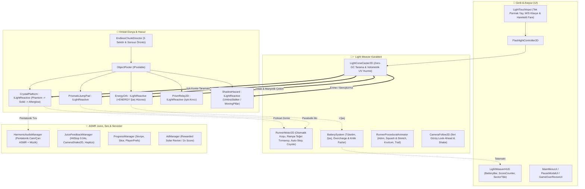

# 🧠 LIGHT WEAVER: Prism Runner - Canlı Proje Hafızası (Cross-Device Memory)

> **Son Güncelleme:** 2026-11-10  
> **Durum:** Faz 2 Tamamlandı — Faz 1 Düzeltmeleri, Neon Koşucu Fiziği, Otomatik Rampa Tırmanışı & Kamera Takibi Aktif (Faz 3'e Hazır)  
> **Cihaz Eşitleme:** Git Push/Pull (`main` dalı) ile Masaüstü & Laptop senkronizasyonu aktif.  

---

### 📌 1. Temel Proje Kimliği & Hedef
- **Proje:** LIGHT WEAVER: Prism Runner
- **Motor / Teknoloji:** Unity 6 (`6000.3.23f1`, URP 2D)
- **Hedef Platform:** Mobil (Android & iOS — 60/120 FPS Zero-GC) + PC Editör Kontrolleri
- **Tür & Mekanik:** 2D Endless Light-Runner / Hardlight Platformer (Fener ışığıyla boşluğu kristalleştirme)
- **Aktif Çalışma Dizini:** `C:/Users/Yusuf/Documents/GitHub/Light-Weaver` (Unity projesi: `LIGHT WEAVER/`)
- **Tasarım & Takip Referansları:** `Docs/GDD.md`, `Docs/PROJECT_TRACKER.md`, `Docs/plans/task.md`

---

### 🗺️ 2. Mimari Bilgi Haritası (Architecture Graph)
<!-- Token koruyucu: Kod yazmadan önce bu şema incelenir; var olan sınıflar kullanılır, mükerrer sistem üretilmez. -->

---

### 🎨 3. Sanat Yönetimi & Tasarım Dili
- **Görsel Tarz:** High-Contrast Neon Prismatic / Hardlight Sci-Fi 2D
- **Renk Paleti (60-30-10 Kuralı):**
  - Dominant Boşluk (%60): `#05070D` (Zifiri Boşluk) -> `#0B1021` (Derin İndigo)
  - İkincil Kristal Yapı (%30): `#00F0FF` (Neon Siyan), `#B537F2` (Prizmatik Eflatun), `#1A8CFF` (Kristal Mavi)
  - Vurgu / Enerji / Tehlike (%10): `#FFD000` (Fener & Batarya Altını), `#FF6B00` (Sıçrama Halkası Turuncusu), `#FF1E56` (Void Tehlike Kızılı)
- **Juice & ASMR Parametreleri:**
  - Pentatonik cam/arp ses gamı (`C4 - Eb5`), Pitch modülasyonu (`0.95 - 1.35`)
  - *Perfect Weave* mikro Hit-Stop (`0.04s`), Camera Shake (`CameraShake2D`), Squash & Stretch

---

### 🔒 4. Asla Çiğnenmeyecek Kurallar & Kırmızı Çizgiler
- [x] **Kullanıcı Kırmızı Çizgisi:** Keystore / key alias asla otomatik üretilmeyecek; API anahtarları veya `.env` dosyaları asla Git'e commitlenmeyecek.
- [x] **Motor & Performans Kuralı:** `Update()` / `FixedUpdate()` içinde `new`, `GetComponent<T>()`, `FindObjectsOfType`, `Camera.main`, LINQ ve string birleştirme kesinlikle yasaktır (Zero-GC).
- [x] **Unity MCP & Sahne Kuralı:** Sahne ve UI yerleşimleri Editor kurulum araçlarıyla (`LightWeaverSetupUtility`) kalıcı olarak inşa edilir.

---

### ✅ 5. Tamamlanan Son Aşamalar
- [x] **Faz 0 & Faz 1 (Düzeltmelerle Tamamlandı):**
  - `CrystalPlatform.cs`: Işık çekildiğinde `0.40s` *Afterglow* sonrası tamamen görünmez (`SpriteRenderer.enabled = false`, `Phantom` tam zifiri karanlık), 4-noktalı analitik kenar ışık yakalama ve 1:1 elmas parlamaları.
  - `LightConeCaster2D.cs`: Altın kenar ışınlı & neon siyan çekirdekli UV gradyan volümetrik koni mesh'i (`volumetric_beam_gradient.png`).
- [x] **Faz 2 (Karakter Fiziği, Dikey Tırmanış & Kontroller):**
  - `LightTouchInput.cs` & `FlashlightController2D.cs`: Mobil yay sürükleme, sabit fare imlecinin klavyeyi ezmesini önleyen akıllı `W`/`S`/Ok tuşu ve sürükle/hareketli fare kontrolü.
  - `RunnerMotor2D.cs`: Zero-GC `RaycastNonAlloc` tabanlı otomatik koşu, `30°-45°` kristal rampa teğet tırmanışı, otomatik basamak atlama (*Auto Step-Up*), Coyote Time ve boşluk düşüşü yenilemesi.
  - `RunnerProceduralAnimator.cs` & `CameraFollow2D.cs`: Neon vizörlü parçalı koşucu, adım/süzülme animasyonu, ayak altı kıvılcımları, hız izi (`TrailRenderer`) ve look-ahead kamera takibi.
  - `LightWeaverSetupUtility.cs`: Katmanlar (`Player`, `HardlightWorld`), sıfır sürtünme materyali ve ~80m kristal rampa test parkuru kuruldu.

---

### 🎯 6. Sırada Ne Var? (Next Sprint)
- [ ] **Faz 3.1:** `BatterySystem.cs` (Mesafe/odak bazlı pil tüketimi, Kritik Kor `<%20` titreme + Adrenalin hız bonusu, Overcharge `>%95` gökkuşağı fazı ve *Perfect Weave* `+3%` geri kazanım).
- [ ] **Faz 3.2:** `EnergyOrb.cs` (`+ENERGY` altıgen batarya hücreleri, fener ışığıyla manyetik çekim) ve `PrismaticJumpPad.cs` (Işıkla şarj olan sıçrama halkaları) + `PrismRelay2D.cs` (Işık kırıcı prizmalar).
