# 🧠 LIGHT WEAVER: Prism Runner - Canlı Proje Hafızası (Cross-Device Memory)

> **Son Güncelleme:** 2026-11-10  
> **Durum:** v4.0 Sarkaç Halat Salınımı, Basılı Tutmalı Uzun Fener, Bütünleşik Mısır Sanat Seti & Mesafe Bazlı Yumuşak Hava Geçişleri Tamamlandı (Faz 6'ya Hazır)  
> **Cihaz Eşitleme:** Git Push/Pull (`main` dalı) ile Masaüstü & Laptop senkronizasyonu aktif.  

---

### 📌 1. Temel Proje Kimliği & Hedef
- **Proje:** LIGHT WEAVER: Prism Runner
- **Motor / Teknoloji:** Unity 6 (`6000.3.23f1`, URP 2D)
- **Hedef Platform:** Mobil (Android & iOS — 60/120 FPS Zero-GC) + PC Editör Kontrolleri
- **Tür & Mekanik:** 2D Endless Light-Runner / Hardlight Platformer (Fener ışığıyla boşluğu kristalleştirme)
- **Aktif Çalışma Dizini:** `C:/Users/Yusuf/Documents/GitHub/Light-Weaver` (Unity projesi: `LIGHT WEAVER/`)
- **Tasarım & Takip Referansları:** `Docs/GDD.md`, `Docs/PROJECT_TRACKER.md`, `Docs/plans/task.md`

---

### 🗺️ 2. Mimari Bilgi Haritası (Architecture Graph)

```mermaid
graph TD
    subgraph Input_UI ["📱 Girdi & Arayüz (UI)"]
        Touch["LightTouchInput (Sabit 210° Floating Stick, Hold-Only Uzun Fener, PC Fare/WASD)"] --> Aim["FlashlightController2D"]
        Flow["GameFlowManager (Menu/Playing/BlessingSelect/Paused/GameOver)"] --> HUD["LightWeaverHUD (BatteryBar, EclipseBar, JUMP, LONG [HOLD], BURST)"]
        Flow --> Menus["MenuScreensUI (Temiz Ana Menü, Pause, 3'lü Prizma Kartı, SolarRevive)"]
        Flow --> Upg["PrismUpgradeManager (6 Roguelite Prizma Güçlendirmesi)"]
        Safe["SafeAreaFit (Çentikli Ekran Uyumu)"] -.-> HUD
    end

    subgraph Player_System ["🏃‍♂️ Light Weaver Karakteri"]
        Aim --> Cone["LightConeCaster2D (Zero-GC Tarama & Volümetrik Huzme)"]
        Motor["RunnerMotor2D (Koşu, Zıplama/Çift Zıplama, Sarkaç Halat Salınımı, KineticBoost, Step-Up)"]
        Battery["BatterySystem (Tüketim, Overcharge/Ember Fazları, Perfect Weave, Hazard Şoku)"]
        Burst["FlashBurstController (Çift Dokunuş / F / E Şok Dalgası Parry & Gate Kırıcı)"]
        Anim["RunnerProceduralAnimator (Çift Eklemli Adım, İpli Diğer Kol, Dalgalanan Trençkot)"]
        Cam["CameraFollow2D (İleri Görüş Look-Ahead, Respawn Snap & Shake)"]
    end

    subgraph World_Prisms ["💎 Kristal Dünya & Havuz"]
        Director["EndlessChunkDirector (8 Balistik Chunk, 5 Mesafe Eşiği, Geri Dönüşüm)"] --> Pool["ObjectPooler (IPoolable)"]
        Atmosphere["DesertAtmosphereController (SmoothStep Gök, Hamsin Kumu, Sis & Tutulma Geçişi)"] -.-> Director
        Pool --> Platform["CrystalPlatform : ILightReactive (Standard / KineticBoost / FragileShard / UmbraBridge)"]
        Pool --> JumpPad["PrismaticJumpPad : ILightReactive (Kumtaşı Horus Sıçrama Altarı)"]
        Pool --> Gate["PrismLockGate : ILightReactive (Antik Mühür Bariyeri & Eye-of-Ra Kilidi)"]
        Pool --> Anchor["PhotonAnchor : ILightReactive (Horus Halkası — Işık Tutunca Sarkaca İp Atar)"]
        Pool --> Orb["EnergyOrb : ILightReactive (+ENERGY Skarabe Alev Reliği)"]
        Pool --> Hazard["ShadowHazard : ILightReactive (Zincirli Dikilitaş / Kum Hayaleti / Gece Skarabı)"]
        Eclipse["EclipsePursuitWave (Soldan Kovalayan Lanet Dalgası)"]
        Stars["ParallaxStarfield (Gize Piramit & Kumul Paralaksı)"]
    end

    subgraph Juice_Services ["✨ ASMR Juice, VFX, Ses & Servisler"]
        Audio["HarmonicAudioManager (Prosedürel C Minör Pentatonik Cam/Çan ASMR + Space Pad)"]
        Juice["JuiceFeedbackManager (HitStop 0.032s, CameraShake2D, Haptics)"]
        Vfx["WorldVfxManager (Zero-GC EmitParams Parçacık Patlamaları & BeamDustMotes)"]
        Progress["ProgressManager (HighScore, BestDist, UnlockedSector, MobileAimMode, PlayerPrefs)"]
        Ads["AdManager (Faz 6 - Rewarded Solar Revive / 2x Score)"]
    end

    Cone ==>|Işık Konisi Taraması| Platform
    Cone ==>|Işık Konisi Taraması| JumpPad
    Cone ==>|Odak & Manyetik Çekim| Orb
    Cone ==>|Erime / Savuşturma| Hazard
    Orb -.->|+Şarj| Battery
    Platform -.->|Fiziksel Zemin| Motor
    JumpPad -.->|Parabolik İtki| Motor
    Battery -.->|Telemetri| HUD
    Platform -.->|Pentatonik Tını| Audio
```

<!-- Token koruyucu: Kod yazmadan önce bu şema incelenir; var olan sınıflar kullanılır, mükerrer sistem üretilmez. -->

---

### 🎨 3. Sanat Yönetimi & Tasarım Dili (v3.0 — Mısır Gecesi & Trençkotlu Dedektif)
- **Görsel Tarz:** Atmospheric Egypt Mystery Runner / Stylized Konturlu Modüler 2D
- **Renk Paleti (60-30-10 Kuralı):**
  - Gece Çölü & Piramitler (%60): `#080A16` (Gökyüzü), `#2B2540`/`#141122` (Piramitler & Obelisk), `#20181D` (Kumullar)
  - Dedektif Trençkot & Kumtaşı (%30): `#BC945F` / `#DFBE93` / `#A88453` (Bej/Deve tüyü), `#5B4039` / `#836C54` (Fedora şapka, pantolon, kemer), `#1F171A` (Kontur & Çizme)
  - Fener Işığı & Keşif (%10): `#FFD24C` (Pirinç Fener Kehribar-Altını), `#00D8C8` (Antik Turkuaz Hiyeroglif/Scarab), `#F53855` (Anubis/Tapınak Tehlike Kızılı)
- **Juice & ASMR Parametreleri:**
  - Pentatonik cam/arp ses gamı (`C4 - Eb5`), Pitch modülasyonu (`0.95 - 1.35`)
  - *Perfect Weave* mikro Hit-Stop (`0.04s`), Camera Shake (`CameraShake2D`), Squash & Stretch

---

### 🔒 4. Asla Çiğnenmeyecek Kurallar & Kırmızı Çizgiler
- [x] **Kullanıcı Kırmızı Çizgisi:** Keystore / key alias asla otomatik üretilmeyecek; API anahtarları veya `.env` dosyaları asla Git'e commitlenmeyecek.
- [x] **Motor & Performans Kuralı:** `Update()` / `FixedUpdate()` içinde `new`, `GetComponent<T>()`, `FindObjectsOfType`, `Camera.main`, LINQ ve string birleştirme kesinlikle yasaktır (Zero-GC).
- [x] **Unity MCP & Sahne Kuralı:** Sahne ve UI yerleşimleri Editor kurulum araçlarıyla (`LightWeaverSetupUtility`) kalıcı olarak inşa edilir.

---

### ✅ 5. Tamamlanan Son Aşamalar
- [x] **Faz 0 & Faz 1 (Düzeltmelerle Tamamlandı):**
  - `CrystalPlatform.cs`: Işık çekildiğinde `0.40s` *Afterglow* sonrası tamamen görünmez (`SpriteRenderer.enabled = false`, `Phantom` tam zifiri karanlık), 4-noktalı analitik kenar ışık yakalama ve 1:1 elmas parlamaları.
  - `LightConeCaster2D.cs`: Altın kenar ışınlı & neon siyan çekirdekli UV gradyan volümetrik koni mesh'i (`volumetric_beam_gradient.png`).
- [x] **Faz 2 (Karakter Fiziği, Dikey Tırmanış & Kontroller):**
  - `LightTouchInput.cs` & `FlashlightController2D.cs`: Mobil yay sürükleme, sabit fare imlecinin klavyeyi ezmesini önleyen akıllı `W`/`S`/Ok tuşu ve sürükle/hareketli fare kontrolü.
  - `RunnerMotor2D.cs`: Zero-GC `RaycastNonAlloc` tabanlı otomatik koşu, `30°-45°` kristal rampa teğet tırmanışı, otomatik basamak atlama (*Auto Step-Up*), Coyote Time ve boşluk düşüşü yenilemesi.
  - `RunnerProceduralAnimator.cs` & `CameraFollow2D.cs`: Neon vizörlü parçalı koşucu, adım/süzülme animasyonu, ayak altı kıvılcımları, hız izi (`TrailRenderer`) ve look-ahead kamera takibi.
  - `LightWeaverSetupUtility.cs`: Katmanlar (`Player`, `HardlightWorld`), sıfır sürtünme materyali ve ~80m kristal rampa test parkuru kuruldu.

- [x] **Faz 3 (Pil Ekonomisi, Enerji Hücreleri & Prizmatik Mekanikler + Akış Cila):**
  - `BatterySystem.cs`: Mesafe/Odak Lazeri bazlı pil tüketimi, 3 Spektrum Fazı (`Normal`, `Overcharge >%95 / 6x Streak` geniş prizma huzmesi + 3x skor, `CriticalEmber <%20` titreme + %15 Adrenalin hızı + 2x şarj ödülü) ve *Perfect Weave* (`+%3` pil geri kazanımı).
  - `EnergyOrb.cs`: Altıgen siyan çerçeveli altın yıldırım `+ENERGY` (`+12%` / `+24%` Super) hücreleri, `0.14s` ışık odaklanmasında manyetik çekim.
  - `PrismaticJumpPad.cs`: Işıkla şarj olan dairesel neon turuncu/siyan sıçrama halkaları (*Starlight Canopy* yüksek katman çıkışı).
  - `PrismRelay2D.cs`: Fener ışığını çift ikincil huzmeye kırarak kör noktadaki platform/bataryaları aydınlatan elmas prizmalar.
  - `RunnerMotor2D.cs` & `LightWeaverSetupUtility.cs`: Eğimli rampa burunlarında pürüzsüz step-up, kamera respawn snap, diegetik sırt pil göstergesi ve kesintisiz ~70m parkur + 5 yeni prefab kaydedildi.

- [x] **Faz 4 (Sonsuz Bölüm Üretici, 5 Sektör & Gölge Tehlikeleri + Step-Up Düzeltmesi):**
  - `RunnerMotor2D.cs`: Tam yüzey probe'lu `TryAutoStepUp` (platform eklem yerlerinde takılma tamamen giderildi) + sektörel hız çarpanı (`SetSectorSpeedMultiplier`).
  - `SectorProfileSO.cs`: Level 1 (*The Silent Abyss*) – Level 5 (*The Singularity Core*, *Level 4 - The Echo Void* dahil) 5 ScriptableObject sektörü oluşturuldu.
  - `EndlessChunkDirector.cs`: `ObjectPooler` üzerinden 6 balistik-doğrulanmış ritmik chunk (3 irtifa katmanlı Jump Pad çatalı, Prizma köprü, rampa, süzülme, tehlike koridoru) üreten ve geride kalanları geri dönüştüren sonsuz yönetmen.
  - `ShadowHazard.cs` & `FlashBurstController.cs`: 3 sistemik gölge engeli (`MovingShadowPillar`, ışıktan eriyen `UmbraStalker`, ışık emen `VoidLeech`) + Çift Dokunuş/`F`/`E` ile radyal Parlama Patlaması (Flash-Burst Parry) + `ParallaxStarfield.cs`.

- [x] **Faz 5 (Referans Görsel HUD, Menüler, ASMR Pentatonik Ses, Juice & Görsel Cila):**
  - `GameFlowManager.cs` & `ProgressManager.cs`: Tam oyun döngüsü (`MainMenu`, `Playing`, `Paused`, `GameOver`), mesafe/kristal/*Perfect Weave* skor sistemi, PlayerPrefs kalıcı yüksek skor ve **Solar Revive** kurtarma köprüsü (`SpawnReviveSafetyBridge`).
  - `LightWeaverHUD.cs`, `MenuScreensUI.cs` & `SafeAreaFit.cs`: Referans görseldeki birebir sol üst gradyan `BATTERY: XX%` pil barı, sağ üst `LEVEL X - SECTOR` & `31,500` skor sayacı, *Flash-Burst* dolum çubuğu, sektör seçmeli Ana Menü (`L1..L5`), ESC/Pause ve Game Over ekranı (`InputSystemUIInputModule`).
  - `HarmonicAudioManager.cs` & `JuiceFeedbackManager.cs`: Harici ses dosyası gerektirmeyen Do Minör Pentatonik kristal cam/çan ASMR sentezleyicisi, uzay ambient drone, mikro Hit-Stop (`0.032s`), Camera Shake ve mobil haptik titreşim.
  - **Görsel Cila (`LightWeaverSetupUtility.cs`):** URP Post-Processing **Bloom** (`LightWeaverPostProcess.asset`), Hero Cyan Aura, fasetli `256x96` cam kristal dokusu ve doğru katmanlama (`sortingOrder`).

- [x] **v2.0 Derin Oynanış Revizyonu (GDD v2.0 + Solar Revive Bug Fix):**
  - **Solar Revive & Retry Bug Fix:** `RunnerMotor2D.ReviveAtPosition` & `RespawnAtStart` içinde `Physics2D.SyncTransforms()` + `_voidGraceTimer` ile yeniden doğuş anında aynı karede tekrar boşluğa düşme hatası tamamen giderildi; `EndlessChunkDirector.SpawnReviveSafetyBridge` yeniden doğuş çevresini temizleyip `9.5m` güvenli geçici köprü (`ForceGraceSolid`) kuruyor.
  - **4 Kristal Varyantı (`CrystalPlatform.cs`):** `Standard`, `KineticBoost` (+%42 hız fırlatması), `FragileShard` (basıldıktan 0.24s sonra parçalanır) ve **Ters Faz `UmbraBridge`** (karanlıkta katıdır, fener ışığı değerse erir — ışığı yukarı/başka yöne kaçırmayı zorunlu kılar!).
  - **Aktif Zıplama & Kanca & Kilitli Kapılar:** `RunnerMotor2D` üzerinde `Space` / Mobil `JUMP` ile Zıplama + Çift Zıplama, `PrismLockGate.cs` (tepesindeki elmas ışıkla vurulup açılan lazer kapıları), `PhotonAnchor.cs` (dev uçurumlar üstünde ışık halatıyla fırlatan kancalar).
  - **The Eclipse & Roguelite Kartlar:** Soldan kovalayan `EclipsePursuitWave.cs` baskı mekaniği ve sektör geçişlerinde zamanı duraklatıp 3 rastgele güçlendirme sunan `PrismUpgradeManager.cs` kuruldu.

- [x] **v2.1 (360° Fener Rotasyonu, Mobil Ergonomi & Görsel/VFX Cila):**
  - **Tam 360° Fener Rotasyonu:** `LightConeCaster2D` açı kıstırması (`-60°..+65°`) kaldırılarak `-180°..+180°` tam özgür dönüş açıldı; `FlashlightController2D` 90° ötesine dönüldüğünde sadece omuz/kol görselini (`armVisualTransform`) aynalarken `LightConeCaster2D` ve `BeamDustMotes` her açıda `1:1` ölçeğini (`lossyScale=(1,1,1)`) ve birebir fiziksel menzili (`standardRange=10.5m`, `focusedRange=16.0m`) koruyor.
  - **Mobil Çift-Başparmak Kontrol Mimarisi (`LightTouchInput.cs`, `LightWeaverHUD.cs`, `ProgressManager.MobileAimMode`, `MenuScreensUI`):** Yatay ekran kilidi + `EnhancedTouch.Touch` çoklu-dokunma ayrımı. Sol alt tarafta çift-oklu **`MobileJumpBtn`** ve yanında uzunu gösteren fener ikonu (`ui_highbeam_icon.png`) ile bas-aç **`MobileHighBeamBtn`** (`LONG: OFF / ON`, standart/uzun hüzme geçişi) + üstünde `MobileBurstBtn` konumlandırıldı; sağ tarafta ise `AimModeToggleBtn` ile seçilebilen **Mod 0 (`AIM: 360 STICK`)** / **Mod 1 (`AIM: TOUCH POINT`)** aktif.
  - **Görsel Netlik & VFX (`WorldVfxManager.cs`, `CrystalPlatform.cs`, `PrismLockGate.cs`, `LightWeaverSetupUtility.cs`):** 4 kristal varyantına 4 ayrı prosedürel sprite (`crystal_standard`, `crystal_boost`, `crystal_fragile`, `crystal_umbra`), `PrismLockGate` elmas bağlantı hattı (`LineRenderer`), Zero-GC `WorldVfxManager` parçacık patlamaları (`WorldBurstParticles`), `BeamDustMotes` ve derinlik katan paralaks eklendi.

- [x] **v3.0 (Mısır Gizemi Konsepti, Modüler Dedektif Rig'i & 210° Akıllı Fener):**
  - **210° Fener Yayı (`-105°..+105°`) & Sol Uzun Fener (`LightConeCaster2D.cs`, `LightTouchInput.cs`, `LightWeaverHUD.cs`):** Ön+tepe+alt+salınım ivme açısı `-105°..+105°` bandında kilitlendi.
  - **10+ Modüler Parçalı Trençkotlu Dedektif (`FlashlightController2D.cs`, `RunnerProceduralAnimator.cs`):** Şapkalı Kafa, Gövde, Trençkot Etekleri, 2-Eklemli Diz/Bacak ve 2-Eklemli Fener Kolu kuruldu.
  - **3 Katmanlı Mısır Piramit Paralaksı & Kumtaşı Dünyası (`LightWeaverSetupUtility.cs`):** Kesintisiz Gize Piramit/Sfenks panoraması, 4 oyma taş platform (`egypt_plat_*`), 9-Slice işlemeli UI Kit ve `EnergyOrb`/`ShadowHazard` havuz `OnEnable` düzeltmesi uygulandı.

- [x] **v4.0 (Işık Tutmalı Sarkaç Halat Salınımı, Basılı Tutmalı Uzun Fener, Bütünleşik Dünya Sanatı & Dinamik Çöl Hava Geçişleri):**
  - **Sürekli Işıkla Asılı Sarkaç Halat Salınımı (`PhotonAnchor.cs`, `RunnerMotor2D.cs`, `RunnerProceduralAnimator.cs`):** Dedektifin diğer eline (`BackArmPivot` / `det_back_arm_rope.png`) rulo halat eklendi; tavan Horus Güneş Halkasına (`egypt_swing_sconce.png`) fener tutulduğu SÜRECE halat atılıp polar sarkaç fiziğiyle salınım yapılır; ışık halkadan çekilince veya Jump'a basılınca teğetsel sapan ivmesiyle serbest kalınır.
  - **Basılı Tutmalı Uzun Fener (`LightTouchInput.cs`, `LightWeaverHUD.cs`):** `MobileHighBeamBtn` (`LONG [HOLD]` -> basılıyken `LONG: ON`) açık/kapalı kilit yerine yalnızca basılı tutulduğu sürece aktif çalışacak şekilde yenilendi.
  - **Bütünleşik Mısır Dünya Sanatı:** Uyumsuz gemi çapası/Ankh/pembe çizgi kaldırılarak tavan zincirli **Horus Güneş Halkası (`egypt_swing_sconce`)**, saydam alevli **Skarabe Işık Reliği (`egypt_orb_scarab_wisp`)**, düz yan kesit **Kumtaşı Sıçrama Altarı (`egypt_jump_vent_altar`)**, duman kuyruklu **Çöl Kum Hayaleti**, zincirli **Dikilitaş Tuzağı**, sabit kanat titremeli **Gece Skarabı** ve ezilmeyen 1:1 ölçekli **Tapınak Mühür Kapısı (`TempleWardLineMat.mat`)** entegre edildi.
  - **Menü Sadeleştirme & Mesafe Bazlı Yumuşak Hava Geçişi (`MenuScreensUI.cs`, `DesertAtmosphereController.cs`):** Ana menüdeki L1–L5 seviye seçici ve Aim ayar butonu tamamen kaldırıldı (`210°` tek standart). Koşuda metre ilerledikçe (`0m Giza Nightfall` -> `240m Khamsin Sandstorm` -> `520m Necropolis Mist` -> `860m Blood Eclipse` -> `1250m Heart of the Duat`) gökyüzü, piramit aydınlatması, kum fırtınası şeritleri, pus ve URP Bloom/Vignette **SmoothStep** ile yumuşak geçiş yapar.

---

### 🎯 6. Sırada Ne Var? (Next Sprint)
- [ ] **Faz 6.1:** Mobil Mağaza Monetizasyon Altyapısı — Gevşek bağlı ScriptableObject kanallı `AdManager` (Solar Revive / 2x Score ödüllü reklam) ve `IAPManager` (`Remove Ads`).
- [ ] **Faz 6.2:** Android & iOS 21:9 / 16:9 / 4:3 çözünürlük testleri, 60/120 FPS performans & Zero-GC Profiler doğrulaması ve Google Play / App Store uyumluluk kontrolü.
