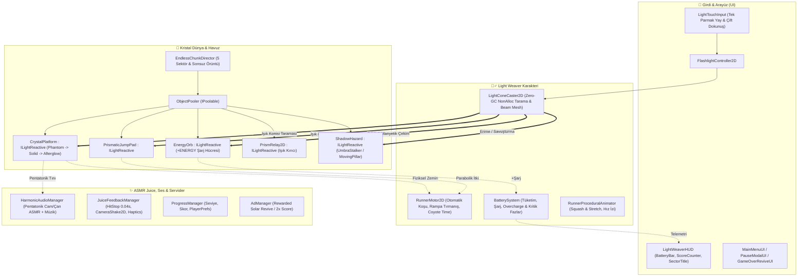

# 🧠 LIGHT WEAVER: Prism Runner - Canlı Proje Hafızası (Cross-Device Memory)

> **Son Güncelleme:** 2026-11-10  
> **Durum:** Faz 0 — GDD, Mimari Altyapı & GitHub Kurulumu Tamamlandı (Unity 6 & MCP Bekleniyor)  
> **Cihaz Eşitleme:** Git Push/Pull (`main` dalı) ile Masaüstü & Laptop senkronizasyonu aktif.  

---

### 📌 1. Temel Proje Kimliği & Hedef
- **Proje:** LIGHT WEAVER: Prism Runner
- **Motor / Teknoloji:** Unity 6 (`6000.3.23f1`, URP 2D)
- **Hedef Platform:** Mobil (Android & iOS — 60/120 FPS Zero-GC) + PC Editör Kontrolleri
- **Tür & Mekanik:** 2D Endless Light-Runner / Hardlight Platformer (Fener ışığıyla boşluğu kristalleştirme)
- **Aktif Çalışma Dizini:** `C:/Users/Yusuf/Documents/GitHub/Light-Weaver` (Unity projesi: `LIGHT WEAVER/`)
- **Tasarım & Takip Referansları:** `Docs/GDD.md`, `Docs/PROJECT_TRACKER.md`, `Docs/plans/task.md`

---

### 🗺️ 2. Mimari Bilgi Haritası (Architecture Graph)
<!-- Token koruyucu: Kod yazmadan önce bu şema incelenir; var olan sınıflar kullanılır, mükerrer sistem üretilmez. -->

---

### 🎨 3. Sanat Yönetimi & Tasarım Dili
- **Görsel Tarz:** High-Contrast Neon Prismatic / Hardlight Sci-Fi 2D
- **Renk Paleti (60-30-10 Kuralı):**
  - Dominant Boşluk (%60): `#05070D` (Zifiri Boşluk) -> `#0B1021` (Derin İndigo)
  - İkincil Kristal Yapı (%30): `#00F0FF` (Neon Siyan), `#B537F2` (Prizmatik Eflatun), `#1A8CFF` (Kristal Mavi)
  - Vurgu / Enerji / Tehlike (%10): `#FFD000` (Fener & Batarya Altını), `#FF6B00` (Sıçrama Halkası Turuncusu), `#FF1E56` (Void Tehlike Kızılı)
- **Juice & ASMR Parametreleri:**
  - Pentatonik cam/arp ses gamı (`C4 - Eb5`), Pitch modülasyonu (`0.95 - 1.35`)
  - *Perfect Weave* mikro Hit-Stop (`0.04s`), Camera Shake (`CameraShake2D`), Squash & Stretch

---

### 🔒 4. Asla Çiğnenmeyecek Kurallar & Kırmızı Çizgiler
- [x] **Kullanıcı Kırmızı Çizgisi:** Keystore / key alias asla otomatik üretilmeyecek; API anahtarları veya `.env` dosyaları asla Git'e commitlenmeyecek.
- [x] **Motor & Performans Kuralı:** `Update()` / `FixedUpdate()` içinde `new`, `GetComponent<T>()`, `FindObjectsOfType`, `Camera.main`, LINQ ve string birleştirme kesinlikle yasaktır (Zero-GC).
- [x] **Unity MCP & Sahne Kuralı:** Sahne ve UI yerleşimleri Editor kurulum araçlarıyla (`LightWeaverSetupUtility`) kalıcı olarak inşa edilir.

---

### ✅ 5. Tamamlanan Son Aşamalar
- [x] **Faz 0.1–0.4:** Master GDD (`Docs/GDD.md`), `PROJECT_MEMORY.md`, GitHub (`RozZyen/Light-Weaver`), Unity 6 (`6000.3.23f1`) ve Unity MCP bağlantısı tamamlandı.
- [x] **Faz 1 (Çekirdek Işık & Kristalleşme Motoru):**
  - `ILightReactive.cs` & `LightReactiveRegistry.cs` (Zero-GC merkezi hedef kaydı)
  - `ObjectPooler.cs` (`IPoolable` tabanlı sıfır tahsisli nesne havuzu)
  - `LightConeCaster2D.cs` (Prosedürel volümetrik ışık konisi mesh'i + açısal tarama + Odak Lazeri modu)
  - `CrystalPlatform.cs` (Phantom `%9` $\rightarrow$ Solid `#00F0FF` $\rightarrow$ `0.48s` Afterglow `#B537F2` durum makinesi)
  - `FlashlightInputPreview.cs` & `LightWeaverPhase1Setup.cs` (Prosedürel fasetli kristal sprite üretimi ve sahne kurulumu)

---

### 🎯 6. Sırada Ne Var? (Next Sprint)
- [ ] **Faz 2.1:** `RunnerMotor2D` (Otomatik koşu, eğimli kristal rampa tırmanışı, Coyote Time ve boşluğa düşme tespiti).
- [ ] **Faz 2.2:** Neon koşucu karakterin (Light Weaver) görsel parçaları, `RunnerProceduralAnimator` ve hız izleri (`TrailRenderer`).
